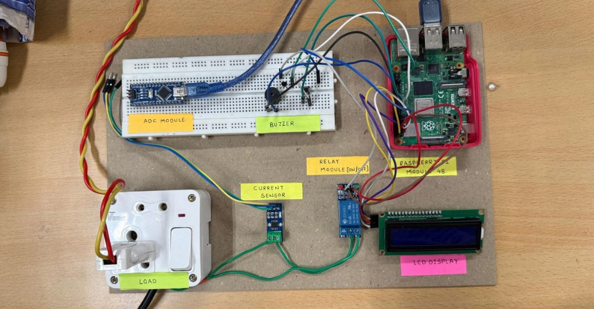
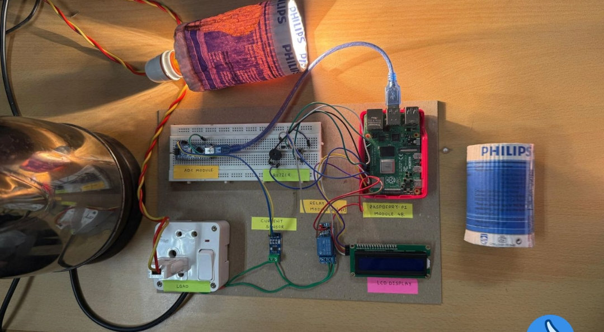

# Power Abuse Monitoring System ⚡

A microcontroller-based power monitoring and overload protection system developed to monitor electrical load consumption and disconnect the supply when a predefined power threshold is exceeded.

## 📌 Project Overview

The system combines current sensing, embedded processing, and relay-based switching to monitor connected electrical loads and respond to overload conditions.

It was developed as a practical electronics project focused on electrical safety, hardware integration, and automatic load protection.

## 🎯 Objectives

- Monitor electrical load current in real time.
- Estimate power consumption using measured current and a fixed supply voltage.
- Compare calculated power against a predefined threshold.
- Disconnect the load through a relay when an overload is detected.
- Display readings and system status on an LCD.
- Provide an audible warning during overload conditions.

## 🛠️ Hardware Components

| Component | Purpose |
|---|---|
| ACS712 Current Sensor | Measures load current |
| Arduino Nano | Reads sensor data and processes measurements |
| Raspberry Pi | Supervisory monitoring and control |
| Relay Module | Controls the load's power supply |
| 16×2 LCD | Displays readings and system status |
| Buzzer | Provides an audible overload alert |
| Push Button | Resets the system after an overload |

## ⚙️ Working Principle

1. The ACS712 sensor measures the current drawn by the connected load.
2. The Arduino Nano reads the sensor output and processes the measurement.
3. Power is estimated using the measured current and the assumed supply voltage.
4. The system compares the calculated power with a predefined threshold.
5. When an overload is detected, the relay disconnects the load and the buzzer provides an alert.
6. The LCD displays the measured values and system status.

## 🔌 System Architecture

**Electrical Load → ACS712 Sensor → Arduino Nano → Relay Control**

The Raspberry Pi provides supervisory monitoring, while the LCD and buzzer provide user feedback.

## 👨‍💻 My Contribution

**Role: Hardware and System Integration Lead**

- Worked on electronic component selection and compatibility.
- Designed and assembled the hardware circuit.
- Integrated the current sensor, relay, LCD, buzzer, and controllers.
- Worked on Arduino–Raspberry Pi communication.
- Tested the hardware under different load conditions.
- Troubleshot circuit connections and system integration issues.

## 💡 Skills Demonstrated

- Embedded Systems
- Arduino Nano
- Raspberry Pi
- Sensor Interfacing
- Circuit Design
- Hardware Integration
- Electronics Testing and Troubleshooting

## 🚧 Future Improvements

---

## 📸 Hardware Prototype & Testing

### Complete Hardware Setup

### Circuit and Connections

### Hardware Testing

- Improved measurement calibration and accuracy.
- Data logging and historical power-consumption analysis.
- IoT-based monitoring and notifications.
- Enhanced overload monitoring and reporting.

---

**Project Domain:** Embedded Systems | Electronics Hardware | Power Monitoring
